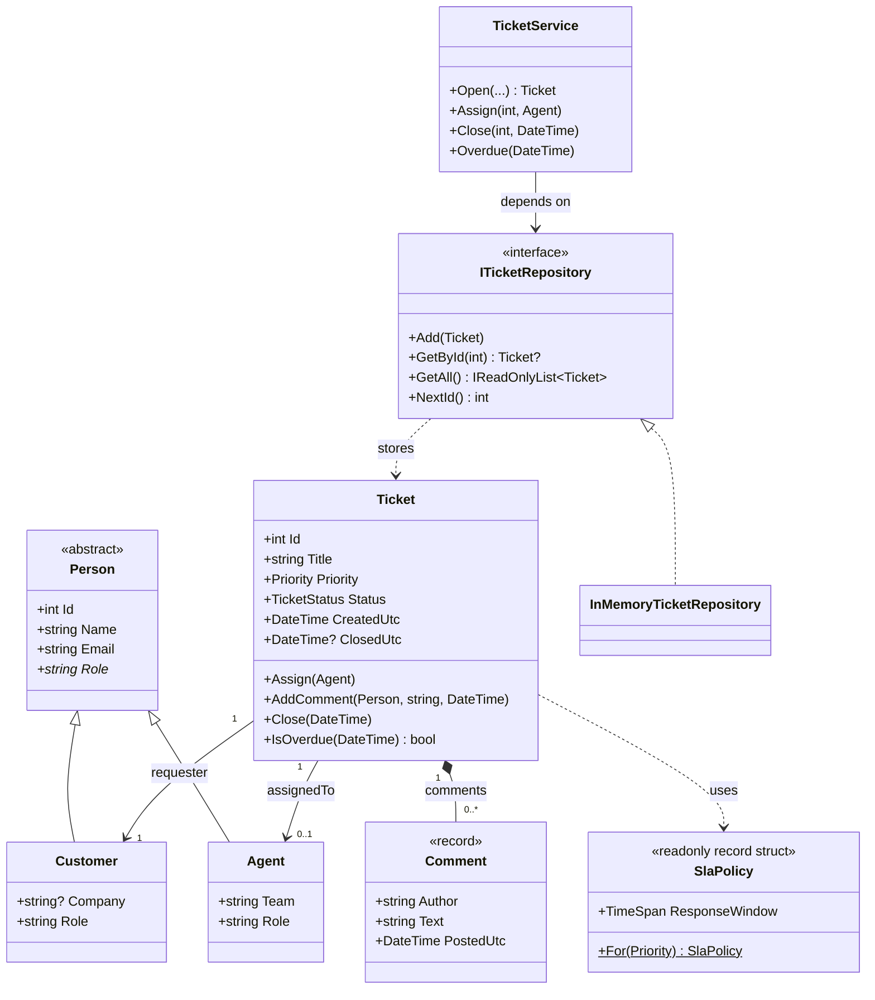

# Class relationship diagram

Renders on GitHub, VS Code (Markdown Preview Mermaid) and any Mermaid viewer.

## Reading the diagram

- **Inheritance (`<|--`)**: `Customer` and `Agent` are kinds of `Person`.
- **Implementation (`<|..`)**: `InMemoryTicketRepository` implements `ITicketRepository`.
- **Composition (`*--`)**: a `Ticket` owns its `Comment`s; they have no life outside it.
- **Association (`-->`)**: a `Ticket` refers to a `Customer` and optionally an `Agent`, which exist independently.
